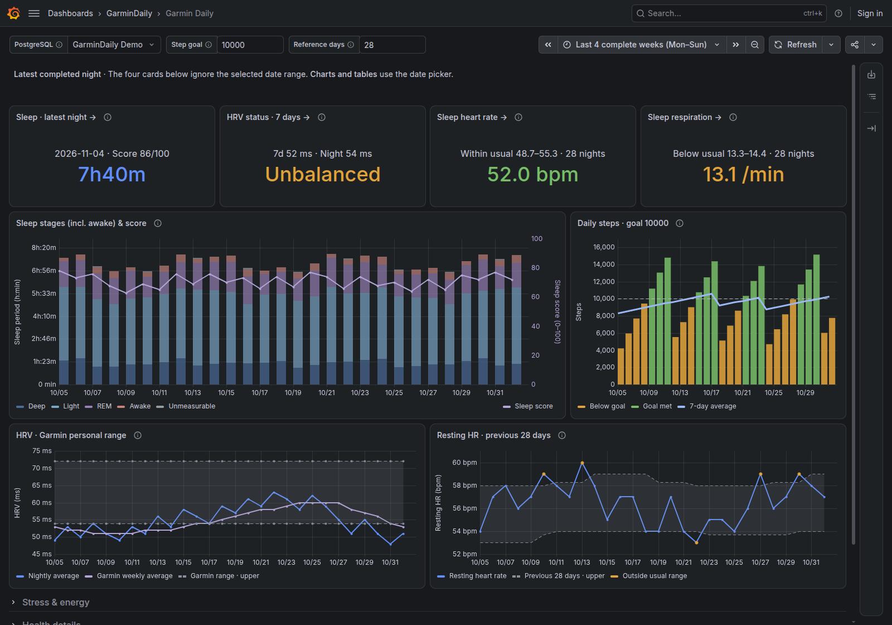
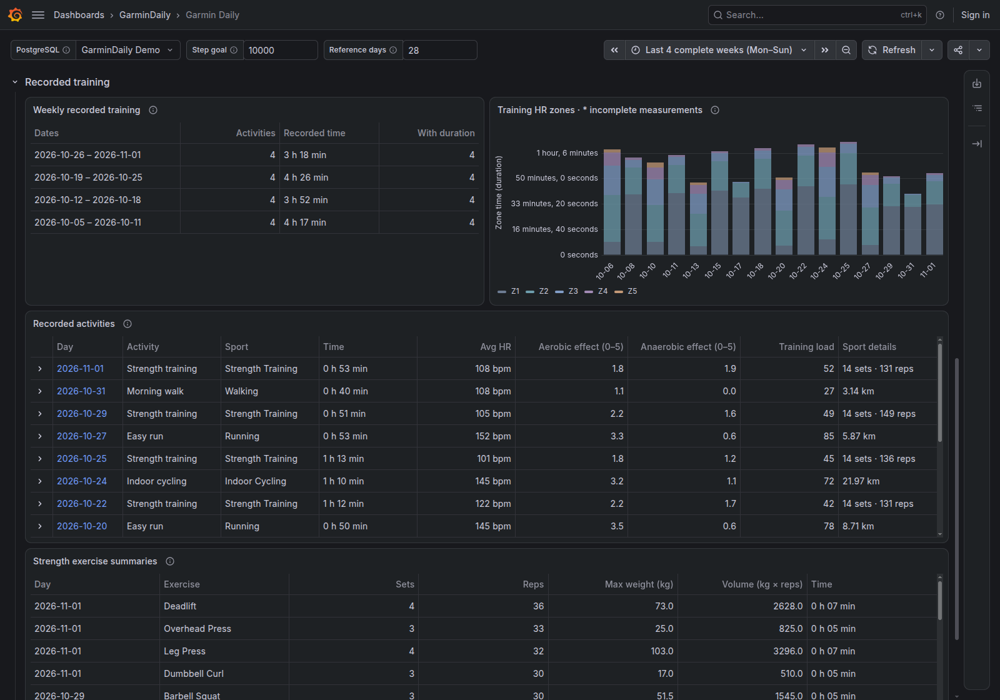

# Garmin Daily dashboard

[Back to GarminDaily](../README.md) · [Dashboard JSON](garmin-daily.json)

A quick health and recovery overview, with details in expandable rows on the
same dashboard. Tested with **Grafana 13.3.0** and GarminDaily's current schema.
All panels and datasources are built into Grafana; no additional panel plugin,
database view or dashboard-specific migration is needed.



*All screenshots use synthetic measurements and workout names, with no connected Garmin account.*

## Import

1. Run GarminDaily's `migrate`, then import some history. The dashboard queries
   all six [data tables](../docs/data-model.md), even if some have no measurements.
2. Add a **PostgreSQL** datasource in Grafana connected to that database, using a
   dedicated read-only role such as `garmin_daily_ro`. Configure TLS for your server.
   Use **Save & test** to verify connectivity.
3. Open **Dashboards → New → Import dashboard**, upload
   [`garmin-daily.json`](garmin-daily.json), choose a folder and import it.
4. In the dashboard's **PostgreSQL** selector, choose your datasource. Set your
   **Step goal** and **Reference days**. Save the dashboard to retain your choices.
5. In Grafana's time settings, select the IANA timezone matching your Garmin
   account if it differs from the browser timezone.

The datasource role needs schema `USAGE` and `SELECT` on the six tables. For an
existing `garmin_daily_ro` role with tables in `public`, an administrator can grant:

```sql
GRANT USAGE ON SCHEMA public TO garmin_daily_ro;
GRANT SELECT ON TABLE public.daily_health, public.daily_sleep, public.daily_hrv, public.activities, public.activity_exercises, public.weight_measurements TO garmin_daily_ro;
```

Create/manage the role through your database administration workflow. The dashboard
uses unqualified table names: for a non-`public` installation, ensure that schema
is in the datasource role's `search_path`. New tables added by future migrations
may require additional reader grants. See [database deployment](../docs/deployment.md).

Importing uses UID `garmin-daily`. An existing dashboard with that UID represents
the same dashboard; check before replacing it. If you choose a different UID,
internal links use the current dashboard's UID and continue to work.

## Make it yours

These are **Grafana dashboard variables**, not collector environment variables.
Hover their information icons for help in the dashboard.

| Control | Variable / JSON setting | Default | Effect |
| --- | --- | --- | --- |
| PostgreSQL | `DS_POSTGRESQL` | Select your datasource | Supplies all SQL queries. |
| Step goal | `STEP_GOAL` | `10000` | Goal line and bar colors on steps; gauge scale and colors in Daily summary. |
| Reference days | `BASELINE_DAYS` | `28` | Previous calendar dates used for personal resting HR, sleep HR and sleep respiration ranges. |
| Timezone | `timezone` | `browser` | Calendar boundaries, completed-day filtering, sleep timestamps and date links. |
| Date range | `time.from` / `time.to` | `now-4w/w` / `now-1w/w` | Four complete Monday–Sunday weeks for historical charts and tables. |

Both numeric variables require a positive whole number. Invalid values fail the
affected queries explicitly. The screenshots use the distributed JSON defaults,
including a configurable 10,000-step goal.

The personal range is P10–P90 of the preceding `BASELINE_DAYS` calendar dates,
excluding the evaluated date. Every required date must have a valid reading;
sleep comparisons also require completed main sleeps. Missing history leaves
the reference unavailable. This setting does **not** change Garmin's HRV status
or Garmin's own HRV baseline.

## Read dates and missing data correctly

- **Top cards:** always the same latest completed main sleep, independently of
  the time picker. Its date is displayed. Older nights are gray and explicitly
  dated; a missing metric does not fall back to another night.
- **Historical charts and tables:** use the time picker. Daily totals exclude
  today. A range including today can show its completed sleep and HRV; an
  unfinished main sleep remains hidden.
- **Card links:** explicitly open 14 dates ending with that night's date. Other
  date links open the surrounding week. Links preserve datasource, goal,
  reference days and timezone.
- **Weekly training:** shows the actual selected date span. The default range
  contains four complete weeks; a custom range can clip a week.
- **Training zones:** `*` marks days where some workouts lack complete zone
  measurements. Hover a bar for its full date and measurement coverage. A gap
  does not mean no workout or zero time in a zone.
- **Missing measurements:** stay missing, rather than turning into zero.
  Reference colors describe comparisons; they are not diagnoses.

Garmin `day` values remain source calendar dates. Changing Grafana's timezone
does not reconstruct those dates from intraday data. Match the account timezone
for consistent boundaries.

## Details on demand

| Row | What you can check |
| --- | --- |
| Stress & energy | Body Battery daily range, day/sleep stress and active/resting calories. |
| Health details | Sleep HR, respiration, stress/rest duration and recorded weigh-ins. |
| Recorded training | Weekly time, HR zones, activities and expandable exercise summaries. |
| Movement details | Weekly intensity and daily step distance. |
| Daily history | Daily measurements and expandable metric details. |



Panel information icons explain units, comparisons and unfamiliar metrics.
Training effect is shown on Garmin's 0–5 scale; larger is not always better.

## Provision from files or GitOps

Use [`garmin-daily.json`](garmin-daily.json) as the dashboard definition with
Grafana's standard [file provisioning](https://grafana.com/docs/grafana/latest/administration/provisioning/#dashboards).
Provision the PostgreSQL datasource separately, with credentials supplied by your
normal secret-management mechanism.

For installation defaults, update the matching entries under `templating.list`
before provisioning:

- `DS_POSTGRESQL`: set `current.value` to your datasource UID.
- `STEP_GOAL` / `BASELINE_DAYS`: keep `query`, `current.text`, `current.value` and
  the selected `options` entry consistent, using strings for their values.
- `timezone`, `time.from` and `time.to`: set Grafana's normal dashboard properties.

The source JSON has no installation hostname, credential, personal timezone or
fixed PostgreSQL datasource UID. Keep those settings in your deployment layer.
Provisioned dashboards should be changed in their source; UI changes may be
disabled or overwritten by provisioning.

## Compatibility and credits

The JSON uses the classic Grafana dashboard format (`schemaVersion: 41`). Older
Grafana versions have not been verified. No compatibility with the InfluxDB
dashboards from other Garmin collectors is implied.

Presentation was inspired by
[`arpanghosh8453/garmin-grafana`](https://github.com/arpanghosh8453/garmin-grafana/tree/main/Grafana_Dashboard),
adapted to GarminDaily's typed PostgreSQL measurements and a short overview with
details on demand.

Grafana references: [import dashboards](https://grafana.com/docs/grafana/latest/visualizations/dashboards/build-dashboards/import-dashboards/)
and [configure PostgreSQL](https://grafana.com/docs/grafana/latest/datasources/postgres/configure/).
